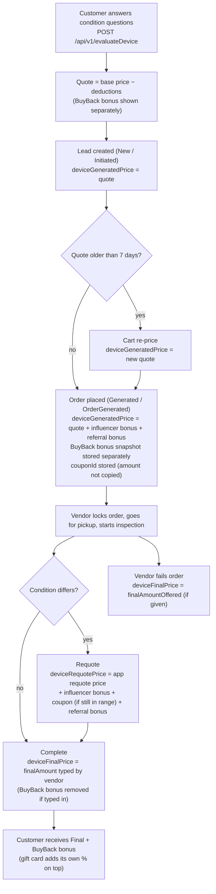

<Callout kind="alert">This page replaces the order given on the older "Device Pricing Fields Overview" page. In the backend code the order is **Generated → Requote → Final**. Requote happens at inspection, **before** completion, and Final is written last.</Callout>

<Callout kind="info">Source: CashkrBackend code (16 Oct 2026). The admin panel (ck-admin) and website (ck-web2.0) sections are based on what the backend shows about them; they will be completed once those codebases are added.</Callout>

## The three price fields

Every customer sale is one `MasterLeads` row. It carries three price columns. All three are stored as **text (String)**, not numbers, and nothing in the database links them. Changing one never recalculates the others.

| Field | Company name | When it is written | Who writes it | Endpoint / function |
|---|---|---|---|---|
| `deviceGeneratedPrice` | **Quoted** | 1. When the customer's quote becomes a lead. 2. Again when the order is placed (bonuses added). 3. Again if an expired cart quote is re-priced. | Customer (web or app) | `POST /api/v1/lead` → `createLead`; `POST /api/v1/lead/:id` → `completeLead`; `POST /api/v1/customer/cart/:leadId/reprice` |
| `deviceRequotePrice` | **Requote** | At the doorstep, after the vendor inspects the device and corrects the condition answers. Empty if the vendor never requotes. | Vendor or cashboy app | `PUT /api/v1/order/requote` → `LeadService.requoteOrder` |
| `deviceFinalPrice` | **Final** | When the vendor completes the pickup. Also written when a vendor **fails** an order and enters an offered amount. | Vendor or cashboy app | `POST /api/v1/order/complete` → `LeadService.completeLead`; `POST /api/v1/order/failed` → `FailedLeadService.cancelOrder` |

## How the price moves through an order

<Steps>

<Step title="1. Quote (evaluateDevice)" icon="calculator">

`POST /api/v1/evaluateDevice` takes the device, its base price and the customer's answers (warranty `W1–W4`, body `B1–B4`, screen `S0–S5`, physical `P…`, technical `T…`, accessories `A…`).

- Each deduction comes from the device's pricing class (`Class<Type>` table). A cell can be flat (`"500"`) or a percentage (`"5%"`).
- Mobile and most types: `quote = base − W − B − S − ΣP − ΣT − missing accessories` (eSIM-only phones lose the ESIM amount first).
- Laptop: base + processor + RAM + storage (+ graphics card) + screen size + owned accessories, then the deductions.
- A device that does not turn on, or nets to zero or less, gets the class `deadPrice`.
- If a BuyBack Days campaign is live for that model and the device turns on, the response adds `buybackBonus` and `totalPrice = price + bonus`. The `price` itself is **not** changed.

Nothing is saved at this step.

</Step>

<Step title="2. Lead and order placement (deviceGeneratedPrice)" icon="file-plus">

- `POST /api/v1/lead` saves the chosen quote as `deviceGeneratedPrice` and stamps the vendor credit cost (`creditPoints`) and `tier`.
- A quote is valid for **7 days** (`QUOTE_VALIDITY_DAYS`). After that, placing the order returns **410** until the customer re-prices it from the cart. Re-pricing works for Mobile, Tablet, Mac, Camera, Headphone, Console and Watch only, not Laptop, Desktop, Drone, TV or AC.
- `POST /api/v1/lead/:id` places the order. In one update it rewrites `deviceGeneratedPrice = quote + influencer bonus + referral (referee) bonus`, stores the BuyBack bonus snapshot in `buybackBonusAmount` / `buybackBonusCampaignId`, and links the coupon through `couponId`.

</Step>

<Step title="3. Inspection requote (deviceRequotePrice)" icon="edit">

`PUT /api/v1/order/requote` runs when the vendor finds a different condition at the doorstep.

- The vendor's corrected answers overwrite the device answer row (`Data<Type>`).
- `deviceRequotePrice = requote price from the vendor app + bonuses the customer keeps`:
  - influencer bonus: always kept
  - coupon: kept only if the new price is still inside the coupon's `minValue` / `maxValue`
  - referral referee bonus: kept
- If the device does not turn on, the BuyBack bonus is removed.
- A `RequoteLogs` row records previous price, new price and changed fields, and `LeadLogs` gets "Order requoted by … Previous price: X, New price: Y".
- The customer gets WhatsApp `requote_done` and email `REQUOTE_DONE`.
- A second requote returns **409 "Order Already Requoted"**.
- If the payout is a gift card and the new amount goes over ₹10,000, the response flags `giftCardUnavailable`.

</Step>

<Step title="4. Completion (deviceFinalPrice)" icon="check-circle">

`POST /api/v1/order/complete` saves `finalAmount` from the vendor as `deviceFinalPrice`, with the IMEI and KYC photos.

- If the vendor typed price + BuyBack bonus as one number, the bonus is stripped so it is not paid twice.
- For gift-card payouts, `final + BuyBack bonus` must be within the ₹10,000 cap and the card is issued before anything is saved.
- WhatsApp `order_completed` shows the price plus the bonus.

</Step>

</Steps>

## Amounts that are NOT inside the three fields

| Amount | Where it lives | Added to which price? | Snapshot or live? |
|---|---|---|---|
| BuyBack Days bonus | `MasterLeads.buybackBonusAmount`, `buybackBonusCampaignId` | Never inside any price field. Paid **on top** of Final. | Snapshot at order placement, never overwritten. Removed at requote if the device does not turn on. |
| Coupon | `MasterLeads.couponId` only (no amount stored) | Added into Requote (if still in range). Not inside Generated. | **Live**: re-read from `Coupon.discount` every time it is needed. |
| Influencer bonus | `CodeRedemption.amount` | Inside Generated (at placement) and Requote. | Snapshot per order. |
| Referral referee bonus | Referral microservice | Inside Generated (at placement) and Requote. | Re-derived from the active program at placement. |
| Gift card bonus (+2% by default) | Computed on display / at issue | On top of Final + BuyBack bonus. | Display uses the fixed rate; issuing may use Woohoo's live rate if the fixed rate is 0. |
| Vendor credits | `creditPoints`, `vendorCreditsPoints` | Not a customer price. It is what the vendor pays CashKr to lock the lead. | Stamped at lead creation / lock. |

## Which price each screen and report reads

Most readers use a fallback: **Final if it exists, else Requote, else Generated**.

| Where | Which value | Notes |
|---|---|---|
| Customer checkout cart | `deviceGeneratedPrice` | Shows quote status and re-price option |
| Customer "My orders" | `payoutAmount` | Final → Requote → Generated, + BuyBack bonus, + gift-card % when the payout is a gift card |
| Vendor app: available orders | `payoutPrice` | +2% when the payout is a gift card |
| Invoice PDF (`GET /api/v1/Invoice/:leadId`) | `payoutAmount` | Falls back to Final → Requote → Generated |
| Gift card amount | Final → Requote → Generated, + BuyBack bonus | Before placement it also adds influencer bonus and coupon to the raw quote |
| Store exchange token | `deviceFinalPrice`, else `deviceGeneratedPrice`, + BuyBack bonus | Amount is fixed on the token when it is generated |
| Public "recently sold" feed, top-models analytics | `deviceFinalPrice` | Completed orders only |
| Influencer leaderboard "payout" | Sum of `deviceFinalPrice` | Completed orders only |
| Referral `order-completed` webhook | `orderAmount = deviceGeneratedPrice`, `finalAmount = deviceFinalPrice` | Sent once, on the customer's first completed order |
| Vendor leaderboard | Requote count and requote rate | Not the price value |

## If you change a price, what is affected?

<Tabs>

<Tab title="Catalog / class prices">

**Changing a model's base price (`Device<Type>.price`) or a class deduction cell (`Class<Type>`)**

- Affects **new quotes only**. Existing leads keep their saved `deviceGeneratedPrice`.
- Also affects a cart re-price, because re-price rebuilds the quote from the current catalog price.
- The backend has no write route for these tables; the admin panel edits them in the database. The catalog cache lives for up to **5 minutes**, so a change can take that long to show.
- Laptop and Desktop credit cost uses price bands (`AddCreditAlgorithm`), so new leads may cost vendors a different number of credits.

</Tab>

<Tab title="deviceGeneratedPrice">

**Editing Quoted on an existing order**

- Changes: checkout cart price, and every screen that falls back to Generated when Requote and Final are empty (customer orders, vendor payout price, invoice, gift-card amount).
- Changes the `orderAmount` sent in the referral webhook, if the order is not yet completed.
- Does **not** change Requote, Final, the BuyBack snapshot, credits already charged, or the coupon.
- A direct database edit sends no customer message and writes no `LeadLogs` line unless the admin tool does so.

</Tab>

<Tab title="deviceRequotePrice">

**Editing Requote**

- Changes what the customer and vendor see until Final is set (it is the second choice in the fallback).
- Does **not** change Final. Once Final exists, Requote is no longer shown in payout amounts.
- Only the requote endpoint sends the `requote_done` WhatsApp and email and writes `RequoteLogs`. A direct edit does none of this.
- Requote counts feed the vendor leaderboard (requote rate). Editing the value does not change the count.

</Tab>

<Tab title="deviceFinalPrice">

**Editing Final**

- Changes invoice amount, customer "My orders" payout, public "recently sold" feed, top-models analytics and influencer leaderboard payout.
- Does **not** change a gift card that was already issued, an exchange token that was already generated, or a referral webhook that was already sent.
- Does not touch vendor credits.
- Remember Final is also filled on **failed** orders (amount offered). Reports should always filter on `primaryStatus = Completed`.

</Tab>

<Tab title="Bonuses and coupons">

- **Coupon amount (`Coupon.discount`)**: the order stores only `couponId`, so editing a coupon's amount after customers used it **changes the amount for every open order** holding that coupon (requote and gift-card calculations re-read it).
- **Influencer `customerBonus`**: placed orders keep their `CodeRedemption.amount`. Only new orders and drafts without a redemption see the new value.
- **BuyBack campaign amount**: placed orders keep their snapshot. Drafts see the live amount.
- **Gift card bonus rate**: affects new gift-card quotes and issues only.
- **Vendor tier and credit rules (`TierConfig`, `ExtraCreditRule`)**: change how many credits a vendor pays to lock a lead, not the customer price. They apply within **10 minutes**.

</Tab>

</Tabs>

## Worked example

| Step | Value | Field |
|---|---|---|
| Base price from catalog | ₹10,000 | sent to `/evaluateDevice` |
| Deductions (scratches, no charger) | −₹2,000 | |
| Quote | ₹8,000 | `deviceGeneratedPrice` on the draft |
| Influencer code bonus | +₹500 | |
| Order placed | **₹8,500** | `deviceGeneratedPrice` |
| BuyBack Days bonus | ₹300 | `buybackBonusAmount` (separate) |
| Coupon applied (₹200) | — | `couponId` only |
| Vendor finds a dent, app requote price ₹7,000 | ₹7,000 + ₹500 influencer + ₹200 coupon | **₹7,700** in `deviceRequotePrice` |
| Vendor completes with ₹7,700 | **₹7,700** | `deviceFinalPrice` |
| Customer receives (UPI/Bank/Cash) | ₹7,700 + ₹300 bonus = **₹8,000** | shown as `payoutAmount` |
| Customer receives (gift card, +2%) | ₹8,000 × 1.02 = **₹8,160** | gift card face value |

## Open questions

- Does the website/app send the quote to `POST /api/v1/lead` with the coupon already included? The backend stores only `couponId` and adds the coupon at requote, so the answer decides whether a coupon can be counted twice. (Unclear from backend code; to be checked in ck-web2.0.)
- How does the vendor app compute its requote price before sending it? (To be checked in the vendor app.)
- Which admin panel screens edit `deviceGeneratedPrice`, `deviceRequotePrice` or `deviceFinalPrice` directly, and do they write `LeadLogs`? (To be checked in ck-admin.)

## Related

- [Backend System Overview](/backend/overview)
- [Pricing & Evaluation](/backend/modules/pricing-and-evaluation)
- [Orders](/backend/modules/orders)
- [BuyBack Bonus Campaigns](/backend/modules/buyback-bonus-campaigns)
- [Coupon](/backend/modules/coupon)
- [Gift Cards](/backend/modules/gift-cards)
