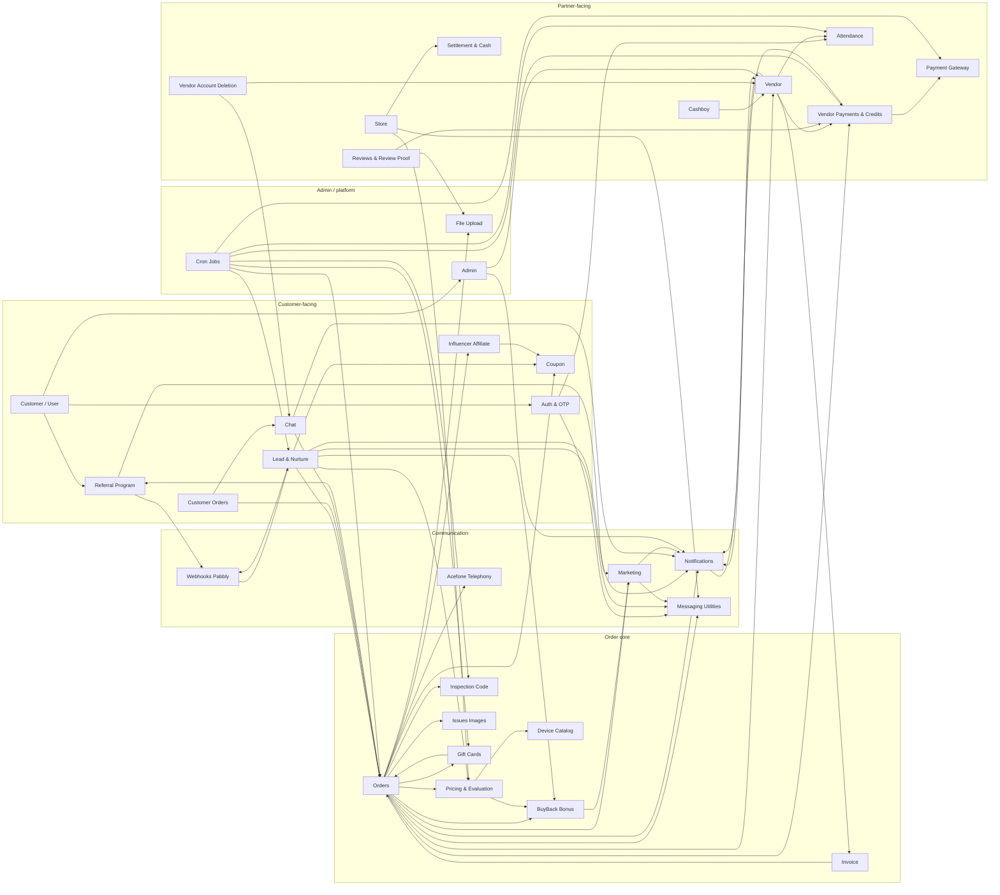

<Callout kind="info">Generated from the CashkrBackend source code (branch feat/acefone-call-record-cache, 16 Oct 2026). Where the code did not answer a question, the page says "Unclear from code". Security findings are kept in an internal note and are not published here.</Callout>

## Tech stack

| **Layer** | **What is used** | **Where** |
|---|---|---|
| Language / runtime | TypeScript on Node.js &gt;= 20.14 (engines), CommonJS output | tsconfig.json, package.json |
| Web framework | Express 4 with helmet, cors (allow-list in src/config/corsOrigins.ts), compression, cookie-parser, morgan, trust proxy = 1 | src/app.ts |
| Database | PostgreSQL via Prisma 7 (prisma-client-js, relationJoins preview, @prisma/adapter-pg, optional Prisma Accelerate in src/utils/prisma.ts). One schema file with 226 models and 98 enums. Migrations in prisma/migrations | prisma/schema.prisma, prisma.config.ts |
| Cache / rate limits | Redis (ioredis / redis): OTP throttle, daily order limit, leaderboard, Woohoo token cache, chat cancel rate limiter, generic cache | src/lib/cache.ts, src/utils/otpThrottle.ts, src/lib/leaderboard.ts, src/integrations/woohoo/redis.ts |
| Realtime | Socket.IO 4 with @socket.io/redis-adapter (customer chat and in-chat order cancellation) | src/socket/ |
| Scheduled work | cron package; 13 jobs started in src/server.ts only on the primary PM2 instance (src/utils/cluster.ts). No message queue (no BullMQ/SQS) | src/jobs/ |
| Auth | JSON Web Tokens (jsonwebtoken), bearer header or accessToken cookie, token blacklist table; admin calls carry an internal service token plus an admin JWT | src/middleware/ |
| Validation | zod and express-validator (used per route, not globally) | various controllers |
| Files | multer (memory/disk, see File Upload module), sharp for image processing, AWS S3 + presigned URLs | src/utils/MulterUpload.ts, src/services/uploadService |
| Email | AWS SES v2 (@aws-sdk/client-sesv2) and nodemailer SMTP, handlebars templates | src/utils/EngineMailerUtility.ts, src/utils/NodeMailerUtility.ts |
| SMS / OTP | 2factor.in (2factor package) | src/utils/SmsUtility.ts |
| WhatsApp | HTTP provider wrapper | src/utils/WhatappsUtility.ts |
| Push | Firebase Admin (FCM), multiple Firebase projects | src/utils/FCMUtility.ts, src/config/firebase/ |
| Payments | Razorpay SDK, PhonePe (pg-sdk-node) | src/services/razorpay, src/services/phonepe |
| Gift cards | Woohoo (Pine Labs) REST API | src/integrations/woohoo/ |
| Telephony | Acefone dial-plan webhooks and CDR | src/controllers/AcefoneController, src/services/acefoneService |
| Automation / marketing | Pabbly webhooks (inbound intents, outbound events and email list sync), Meta Conversions API | src/utils/webhooks.ts, src/utils/PabblyEmailUtility.ts, src/utils/metaCapi.ts |
| Chatbot | CX Genie (API-key protected lookup endpoints) | src/routes/chatbot, src/middleware/cxgenieAuth.middleware.ts |
| Logging | winston with daily rotate files, log redaction helper | src/utils/logger.ts, src/utils/logRedaction.ts |
| Build / run | webpack bundle to dist/server.js; PM2 single fork instance named CashkrBackend (ecosystem.config.js); pnpm build && pm2 reload (DEPLOYMENT.md); CodeBuild buildspec.yml; port from PORT (default 9000) | repo root |
| Tests | Jest (tests/, ~60 spec files) | jest.config.ts |

## How requests are wired

- src/app.ts mounts src/routes/index.ts at /api/v1 and mounts the newer admin routers directly at /api/v1/admin/\*.

- Public, non-API mounts: /c/:token (click redirect), /u (unsubscribe), /ses (SES bounce/complaint via SNS), /app-open (app deep link), /r/:code (influencer short link), /health, and / (HTML docs page).

- The request body is JSON up to 10 MB. The raw body is kept on req.rawBody for HMAC verification (Razorpay webhook).

- Every request gets a Prisma client via databaseMiddleware and a global error handler formats failures.

## Auth guards

| **Guard** | **File** | **Who passes** |
|---|---|---|
| authorize | src/middleware/authorize.ts | Customer, Vendor, Cashboy or StoreVendor JWT (\_id claim), not blacklisted. Sets req.user.userKind |
| optionalAuthorize | src/middleware/optionalAuthorize.ts | Same, but anonymous requests pass through |
| VerifyJWT | src/utils/auth.middleware.ts | Customer-only JWT (older helper) |
| authenticateAdmin (+ checkAdminRole) | src/middleware/admin-auth.middleware.ts | Admin panel requests: gateway headers plus a JWT with type "admin". Role check uses the AdminRole enum |
| cxgenieAuthMiddleware | src/middleware/cxgenieAuth.middleware.ts | CX Genie bot, by API key header |
| Signature guards | per route | Razorpay HMAC and PhonePe callback check on req.rawBody (src/controllers/vendorPayment/\*.controller.ts), SNS signature (src/utils/snsSignature.ts), Pabbly X-Webhook-Secret header plus a per-IP rate limiter on the intent webhook |

## All modules

Endpoint counts are unique HTTP routes owned by the module (a route that is also listed under another module for context is counted once, under its owner). Socket events, crons and internal helpers are not counted. Status: **Complete** = routed, guarded and used end to end; **Partial** = works but has unrouted or stubbed parts, or the admin half lives outside this repo; **Unused** = present in code or schema but nothing in this backend drives it.

| **\#** | **Module** | **One-line purpose** | **Endpoints** | **Status** |
|---|---|---|---|---|
| 1 | [Auth & OTP](/backend/modules/auth-and-otp) | Phone/email OTP login for customers and partners, JWT issue/refresh, token blacklist, inspection OTP | 11 | Complete |
| 2 | [Customer / User](/backend/modules/customer-user) | Customer registration, profile, payout details, addresses, self-service deletion | 10 | Complete |
| 3 | [App Link / Firebase ID](/backend/modules/app-link-firebase-id) | Android deep-link interstitial and FCM token registration | 2 | Complete |
| 4 | [Admin](/backend/modules/admin) | Admin gateway guard, customer block, fraud registry, activity-log search, vendor status | 7 | Partial |
| 5 | [Device Catalog](/backend/modules/device-catalog) | Brands, series, variants and the per-device-type Device/Class/Data tables | 6 | Complete |
| 6 | [Pricing & Evaluation](/backend/modules/pricing-and-evaluation) | Quote calculation from base price, condition answers and deductions | 1 | Complete |
| 7 | [BuyBack Bonus Campaigns](/backend/modules/buyback-bonus-campaigns) | Time-boxed bonus on top of the quote, plus the BuyBack Days wave sender | 3 | Complete |
| 8 | [Search](/backend/modules/search) | Device autocomplete/search index, city and pincode lookup | 8 | Complete |
| 9 | [Analytics / Top Selling](/backend/modules/analytics-top-selling) | Top-selling device lists and the public recent-completed-orders feed | 5 | Partial |
| 10 | [Model Request](/backend/modules/model-request) | Customers ask for a device model that is not listed yet | 1 | Complete |
| 11 | [Corporate Buyback](/backend/modules/corporate-buyback) | Inbound B2B lead form | 1 | Partial |
| 12 | [Orders (MasterLeads lifecycle)](/backend/modules/orders) | Order state machine from placement to vendor assignment, pickup, requote, completion or failure | 22 | Complete |
| 13 | [Customer Orders](/backend/modules/customer-orders) | Customer-facing order list, detail, cart, cancellation request | 7 | Complete |
| 14 | [Issues Images / Inspection](/backend/modules/issues-images-inspection) | Option images shown during inspection | 1 | Complete |
| 15 | [Inspection Code](/backend/modules/inspection-code) | One-time code the vendor needs from the customer to start inspection | 1 | Complete |
| 16 | [Invoice](/backend/modules/invoice) | PDF invoices for customers and vendor statements | 1 | Complete |
| 17 | [Lead & Nurture](/backend/modules/lead-and-nurture) | Lead capture, 10-minute nurture cron, hot-lead sweep, WhatsApp bot intents | 6 | Complete |
| 18 | [Store / Store Leads / Store Vendors](/backend/modules/store-store-leads-store-vendors) | Walk-in store flow with exchange tokens and settlement | 10 | Partial |
| 19 | [Webhooks (Pabbly)](/backend/modules/webhooks) | Inbound WhatsApp bot intent and opt-out webhooks | 2 | Complete |
| 20 | [Messaging Utilities](/backend/modules/messaging-utilities) | SMS (2Factor), email (SES / EngineMailer), WhatsApp (Pabbly), templates | 0 | Complete |
| 21 | [Marketing](/backend/modules/marketing) | Banners, newsletter, click redirects, unsubscribe, SES events, campaign senders, Meta CAPI | 10 | Complete |
| 22 | [Notifications](/backend/modules/notifications) | FCM push, notification opens, vendor announcements and in-app banners | 16 | Complete |
| 23 | [Vendor](/backend/modules/vendor) | Partner profile, finance views, training hub, leaderboard, app config | 26 | Complete |
| 24 | [Vendor Stories](/backend/modules/vendor-stories) | Story pages shown in the vendor app | 6 | Complete |
| 25 | [Attendance](/backend/modules/attendance) | Login punch-in, geofenced heartbeats, auto punch-out, admin overrides | 11 | Complete |
| 26 | [Petrol Surge](/backend/modules/petrol-surge) | Vendor fuel-surcharge claims | 3 | Partial |
| 27 | [Issue Report](/backend/modules/issue-report) | Vendor issue tickets with message threads | 2 | Partial |
| 28 | [Vendor Account Deletion](/backend/modules/vendor-account-deletion) | Partner deletion request, ops approve/reject, purge | 7 | Complete |
| 29 | [Vendor Payments & Credits](/backend/modules/vendor-payments-and-credits) | Credit purchases, debits per order, UTR approvals, credit logs | 6 | Partial |
| 30 | [Payment Gateway (Razorpay, PhonePe)](/backend/modules/payment-gateway) | Gateway orders, HMAC verify, webhooks, reconcile cron | 13 | Complete |
| 31 | [Settlement & Cash](/backend/modules/settlement-and-cash) | Daily store settlements, disputes, admin overview | 8 | Partial |
| 32 | [Cashboy](/backend/modules/cashboy) | Field agents attached to a vendor | 4 | Complete |
| 33 | [Gift Cards (Woohoo)](/backend/modules/gift-cards) | Amazon gift card as customer payout, Woohoo issuance and reconcile | 6 | Complete |
| 34 | [Exchange Token](/backend/modules/exchange-token) | Store-flow token verified at settlement (routes owned by Store) | 0 | Complete |
| 35 | [Coupon](/backend/modules/coupon) | Coupon rules, apply/remove on a lead, public coupon list | 5 | Complete |
| 36 | [Abandoned Coupon Program](/backend/modules/abandoned-coupon-program) | Admin CRUD for abandoned-cart coupon programs | 5 | Unused |
| 37 | [Referral Program](/backend/modules/referral-program) | Proxy to the external referral microservice, bonus stamping, webhooks | 34 | Complete |
| 38 | [Influencer Affiliate](/backend/modules/influencer-affiliate) | Short links, cookie attribution, discount validate, admin reporting | 15 | Complete |
| 39 | [Reviews & Review Proof](/backend/modules/reviews-and-review-proof) | Customer reviews, vendor-uploaded review proof with credit refund | 13 | Partial |
| 40 | [Chat (Socket.IO)](/backend/modules/chat) | Customer–vendor chat rooms, location sharing, in-chat order cancellation | 6 | Partial |
| 41 | [Chatbot (CX Genie)](/backend/modules/chatbot) | API-key lookups used by the CX Genie bot | 2 | Complete |
| 42 | [Acefone Telephony](/backend/modules/acefone-telephony) | Dial-plan webhook that routes a DID call to the right party | 2 | Partial |
| 43 | [Terms & Conditions](/backend/modules/terms-and-conditions) | Versioned terms sections and per-user acceptance | 15 | Complete |
| 44 | [Careers](/backend/modules/careers) | Public job board and HR application inbox | 13 | Complete |
| 45 | [Wipe (ckwipe)](/backend/modules/wipe) | Data-erasure reports, certificates and license purchases | 11 | Complete |
| 46 | [File Upload](/backend/modules/file-upload) | Multer limits, validation, S3 upload helper | 0 | Complete |
| 47 | [Encryption & Security utils](/backend/modules/encryption-and-security-utils) | Field encryption, log redaction, fraud hashes, CORS, error handler, unused payload encryption | 0 | Partial |
| 48 | [Health & Docs](/backend/modules/health-and-docs) | /health, / docs page, build and deploy | 2 | Complete |
| 49 | [Cron Jobs](/backend/modules/cron-jobs) | The 13 scheduled jobs started in src/server.ts | 0 | Complete |
| | Total unique endpoints | | 346 | |

## Module dependency map

Arrows mean "calls or writes into". Only the main call paths are drawn; the per-module Dependencies lines list everything.

## End-to-end order flow

For how the three prices relate, see [Device Price Lifecycle](/backend/device-price-lifecycle).

Price terms used by the company and the code: **Quoted** = deviceGeneratedPrice (first system quote), **Requote** = deviceRequotePrice (system price at inspection), **Final** = deviceFinalPrice (what the vendor actually paid).

| **Step** | **What happens** | **Module** | **Entry point (route → function, file)** |
|---|---|---|---|
| 1 | Customer picks a device and answers condition questions; a quote is computed | Device Catalog, Pricing & Evaluation | POST /api/v1/evaluateDevice → computeEvaluationPrice (src/controllers/Evaluations) |
| 2 | Lead is created with the Quoted price; per-customer daily cap checked | Lead & Nurture, Orders | POST /api/v1/lead → LeadController.registerNewLead → LeadService2.createLead (src/services/lead/createLead.ts); checkOrderLimit (src/services/dailyLimit) |
| 3 | Quote kept in the checkout cart for 7 days; resume link generated | Customer Orders | CheckoutCartService.list/reprice (src/services/checkoutCart), CheckoutUrlGenerator (src/utils/checkoutUrlGenerator.ts) |
| 4 | Coupon applied; BuyBack bonus snapshot taken; influencer or referral bonus added | Coupon, BuyBack Bonus, Influencer, Referral | Coupon.applyCoupon (src/services/Coupon), src/services/lead/orderBonuses.ts, bonus added in LeadService2.completeLead |
| 5 | Order placed: status Generated/OrderGenerated, inspection OTP row, address snapshot, WhatsApp order_placed_successfully; then auto-assign, reserve or broadcast to vendors | Orders, Notifications, Messaging | POST /api/v1/lead/:id → LeadController.completeLead → LeadService2.completeLead → processLeadAssignmentAsync (autoAssignLeadToVendor, LeadReservationService.reserveLeadForVendor, NotificationService.handleLeadBroadcastNotifications) |
| 6 | Vendor sees available orders and locks one: InProgress/Assigned, credits debited, customer told | Orders, Vendor, Vendor Payments & Credits | GET /api/v1/order/available → GetOrdersController.getAvailableOrders; POST /api/v1/order/lock → LeadService.processLeadLock (src/services/lead/masterLead.service.ts), debitVendorCredits (src/utils/vendorCredits.ts) |
| 7 | Pickup: vendor marks OutForPickup, requests the inspection code, customer code is verified, InspectionStarted and the timer begins | Orders, Inspection Code, Auth & OTP | PUT /api/v1/order/updateVendorLeadStatus; GET /api/v1/sendInspectionCode → sendInspectionCodeOnce; POST /api/v1/otp/lead/verify; startIfNotStarted (src/services/lead/inspectionTimer.service.ts) |
| 8 | Inspection and requote: photos uploaded, Requote price stored, customer notified | Orders, Issues Images, File Upload | PUT /api/v1/upload/reqoteImages; PUT /api/v1/order/requote → LeadService.requoteOrder; GET /api/v1/issuesImages |
| 9 | Payout to customer: UPI/bank details or gift card; vendor pays cash/UPI/bank and uploads proof, or CashKr issues an Amazon gift card via Woohoo | Customer / User, Orders, Gift Cards | POST /api/v1/user/payment; PATCH /api/v1/order/:id/payment-method; issueGiftCardForLeadSync (src/services/giftCard/giftCardPayout.service.ts) |
| 10 | Completion: Final price stored, documents saved, Completed/Completed, push/email/WhatsApp, referral order-completed webhook, Meta CAPI event; invoice available | Orders, Notifications, Referral, Marketing, Invoice | POST /api/v1/order/complete → LeadService.completeLead → finalizeLeadCompletion; GET /api/v1/Invoice/:leadId |
| Alt | Failure at any step by vendor or customer: Failed/Failed plus the to-be-failed queue, finalised by ops in ck-admin | Orders, Customer Orders, Chat | POST /api/v1/order/failed → FailedLeadService.cancelOrder; POST /api/v1/customer/lead/:leadId/cancel-request → orderCancellationService.requestCustomerCancellation; socket order_cancel_request |
